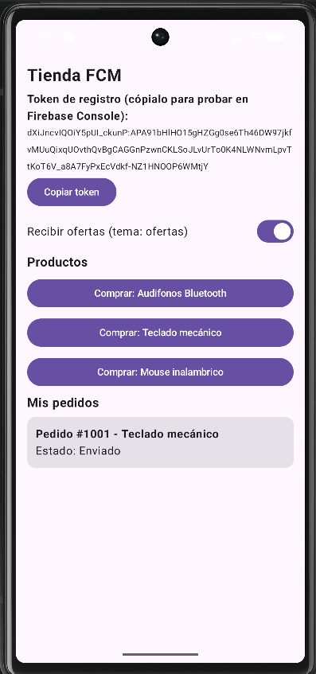
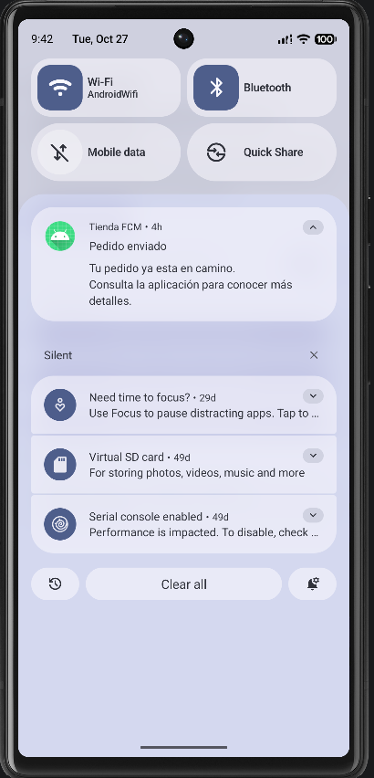
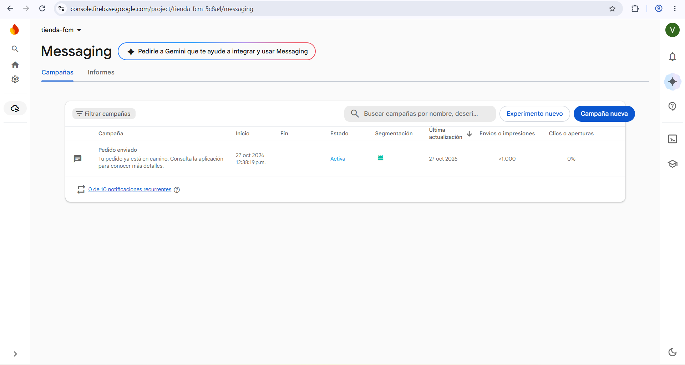

# Tienda FCM

Aplicación móvil Android de comercio electrónico que utiliza **Firebase Cloud Messaging (FCM)** para enviar notificaciones push sobre el estado de los pedidos y promociones.

Proyecto de la asignatura **Desarrollo de aplicaciones para dispositivos móviles**, Ingeniería de Sistemas, Universidad de Nariño (Ipiales).

---

## Descripción

La aplicación simula una tienda en línea donde el usuario puede "comprar" productos y recibir notificaciones pesh cuando cambia el estado de su pedido, sin tener que abrir la aplicación para consultarlo. Sirve comoejercicio práctico para demostrar el funcionamiento de los servicios de notificaciones push y comuncicaciones en Android.

## Funcionalidades

- Obtención y visualización del **token de registro** de FCM, con opción de copiarlo.
- Solicitud del **permiso de notificaciones** (obligatori en Android 13 y superior).
- Lista de productos y creación de pedidos.
- **Actualización del estado del pedido** al recibir una notificación con datos personalizados (`pedido_id` y `estado`).
- Suscripción al **tema `ofertas`** para recibir promociones dirigidas a un grupo de usuarios.
- Canal de notificaciones `pedidos` con prioridad alta.
- Apertura de la aplicacioón al tocar la notificaión, con la app en primer plano, en segundo plano o cerrada.

## Tecnologias

- Kotlin
- Jetpack Compose
- Firebase Cloude Messaging (FCM)
- Android Studio
- Gradle (Kotlin DLS)

## Estructura del código

| Archivo                         | Función                                                                                 |
|:--------------------------------|:----------------------------------------------------------------------------------------|
| `MainActivity.kt`               | Pantalla principal (Compose): token, permiso, tema `ofertas`, productos y pedidos.      |
| `MyFirebaseMessagingService.kt` | Servicio que recibe los mensajes de FCM, actualiza el pedido y muestra la notificación. |
| `Order.kt`                      | Modelo `Order` y repositorio en memoria `OrderRepository`.                              |
| `AndroidManifest.xml`           | Permisos, registro del servicio FCM y canal de notificaciones por defecto.              |

## Requisitos

- Anfroid Studi (versión reciente).
- Emulador con imagen **Google Play** o un celular android.
- Una cuenta de Google para usar Firebase.

## Configutación

1. Clona el repositorio:
    ```bash
    git clone https://github.com/VictorMH07/tienda-fcm.git
   ```
2. Abre el proyecto en Android Studio y espera a que termine la sincronización de Gradle.
3. Crear un proyecto en [Firebase Console](https://console.firebase.google.com).
4. Registra una app Android con el nombre de paquete `com.exampletiendafcm`.
5. Descarga el archivo `google-service.json` y colócalo en la carpeta `app/`.

    > Este archivo **no esta incluido en el repositorio** por seguridad. cada persona debe usar el de su propio proyecto en Firebase.
6. Ejecuta la aplicación en un emulador con Google Play o enun dispositivo real.

## Cómo probar las notificaciones

1. Abre la app, ecepta el permiso de notificaciones y presiona **Comprar** en un producto.
se crea el pedido **#1001** con estado "Pedido recibido".
2. Copia el token que muestra la app.
3. En Firebase Console ve a **Messaging** y crea una campaña de **Notificaciones**:
    - **Titulo:** `Pedido enviado`
    - **Texto:** `Tu pedido ya está en camino. Consulta la aplicación para conocer más detalle.`
    - **Destino:** aplicación de usuario (`com.example.tiendafcm`), o usa **Enviar mensaje de prueba** con el token.
    - **Opciones adicionales**
      - Canal de notificación de Android: `pedidos`
      - Datos personalizados: `pedido_id` = `1001` y `estado` = `Enviado`
4. Publica la campaña y revisa el dispositivo:
    - **App en primer plano:** llega la notificación y el pedido pasa a "Enviado".
    - **App con segundo plano o cerrada:** aparece en la barra de notificaciones. Al tocarla se abre la app y se actualiza el estado.
5. Para probar **temas**, activa el swith *Recibir ofertas* en la app y envia una campaña añ tema `ofertas`.

> Nota: el `pedido_id` enviado debe coincidor con el número del pedido que muestra la app. La lista de pedidos se guarda solo en memoria, por lo que se pierde si el sistema cierra la aplicación.

## Capturas

| Pantalla principal                            | Notificaciones recibidas                  | Campaña en Firebase                          |
|:----------------------------------------------|:------------------------------------------|:---------------------------------------------|
|  |  |  |

## Seguridad y buenas prácticas

- `google-service.json` está excluido del repositorio mediante `.gitignore`.
- Las notificaciones no incluyen información confidencial en su contenido visible.
- Se solicita el permiso de notificaciones al usuario y se verifica antes de mostrar avisos.
- Las credenciales para enviar mensajes deben mantenerse únicamente en un servidor autorizado, nunca dentro de la aplicación.
- En una aplicación real, los cambios importantes de estado deben validarse en el servidor.

## Limitaciones

- Los pedidos se almacenan en memoria y no persisten entre sesiones.
- El envio se realiza desde Firebase Console; no hay servidor propio.
- La entrega puede retrasarse por problemas de conectividad o restricciones del dispositivo.
- El usuario puede desactivar las notificaciones desde los ajustes del sistema.

## Posibles mejoras

- Guardar los pedidos en una base de datos local (Room) o remota (Firestore).
- Enviar el token a un servidor propio y emitir las notificaciones desde allí.
- Agregar inicio de sesión para asociar el token a cada usuario.
- Mostrar un historial de notificaciones recibidas.